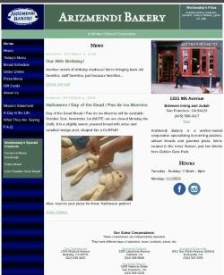
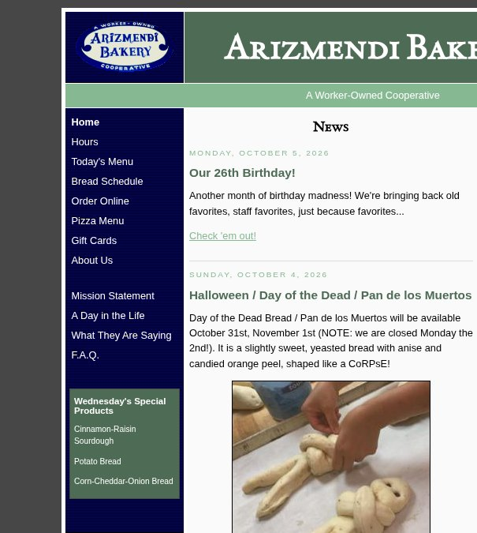

# Website & Listing Check: Arizmendi Bakery

**Worker-owned bakery & pizza** · Inner Sunset, San Francisco, CA · arizmendibakery.com · Checked Oct 14, 2026

**What's working:** The site is fast and light (Lighthouse mobile score 96, 94 KB total). It's kept current, with news posted Oct 5. Hours, address and phone are on the homepage, and "Order Online" is easy to find. Your hours, phone and address match on Yelp and Apple Maps.

## At a glance

| Check | Result | Note |
|---|---|---|
| Listings match the site | ✅ | Yelp + Apple Maps: 1331 9th Ave, (415) 566-3117, Tue–Sun 7:30am–6pm, Mon closed. Google: not verified |
| Phone-friendly | ❌ | Page is fixed at 780 px wide, so phones show a shrunken desktop page with small text |
| Tap-to-call | ⚠️ | Phone number is plain text, not a tap-to-call link |
| Speed on mobile | ✅ | Lighthouse mobile 96/100; main content shows in about 2.3 s |
| Secure (https) | ✅ | Valid certificate (Let's Encrypt, renews by Dec 12, 2026) |
| Links | ⚠️ | 21 checked; 2 sister-bakery links (Oakland, Mission) didn't load for us; Facebook blocks checkers |
| Found in local search | ⚠️ | Title is just "Arizmendi Bakery"; no description, no business schema, no sitemap |
| Reviews | ✅ | Yelp 4.5★ from 2.4k reviews; Google rating not verified |
| Clear next step | ✅ | "Order Online!" link on the homepage |

## What we found

- **Phones get a shrunken desktop page.** The layout is a fixed 780 px wide, so on a phone everything is about half size and people have to pinch-zoom to read the menu or hours. Most visitors are on phones.
- **The number isn't tap-to-call.** On a phone, a one-tap "Call" button is often the main thing people want.
- **Search engines get very little to work on.** The page title doesn't say "bakery" or "Inner Sunset/San Francisco". There's no meta description (the snippet under your name in Google), no LocalBusiness/Bakery schema with your hours and address, and no sitemap.xml.
- **Two sister-co-op links didn't load** for us (lakeshore.arizmendi.coop and valencia.arizmendi.coop). Please check them in a browser.

## Top 3 fixes

1. **Make the layout phone-friendly**: change the viewport to `width=device-width` and let the side columns stack under the news on small screens. It's a CSS change, so no redesign is needed. _(1–3 hours for a web person)_
2. **Make the phone number a tap-to-call link** (`tel:+14155663117`) in the header and footer. _(Free, ~10 min)_
3. **Rename the page title to "Arizmendi Bakery: Bread, Pastries & Pizza in the Inner Sunset, SF"**, add a one-line meta description and Bakery schema with your hours, and fix or remove the two sister-bakery links. _(~30–60 min)_

_How we checked: public website, Yelp and Apple Maps only, Oct 14, 2026. Speed is from Lighthouse 12 (mobile, simulated slow 4G). The Google profile wasn't checked directly, so confirm it matches. Listings change over time._

Free audit format by Halcyon Days · halcyondaylight.com
